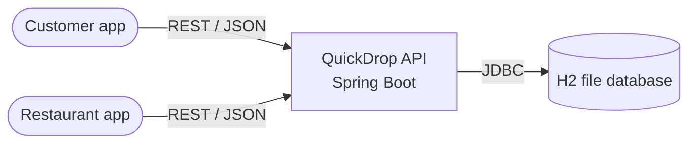
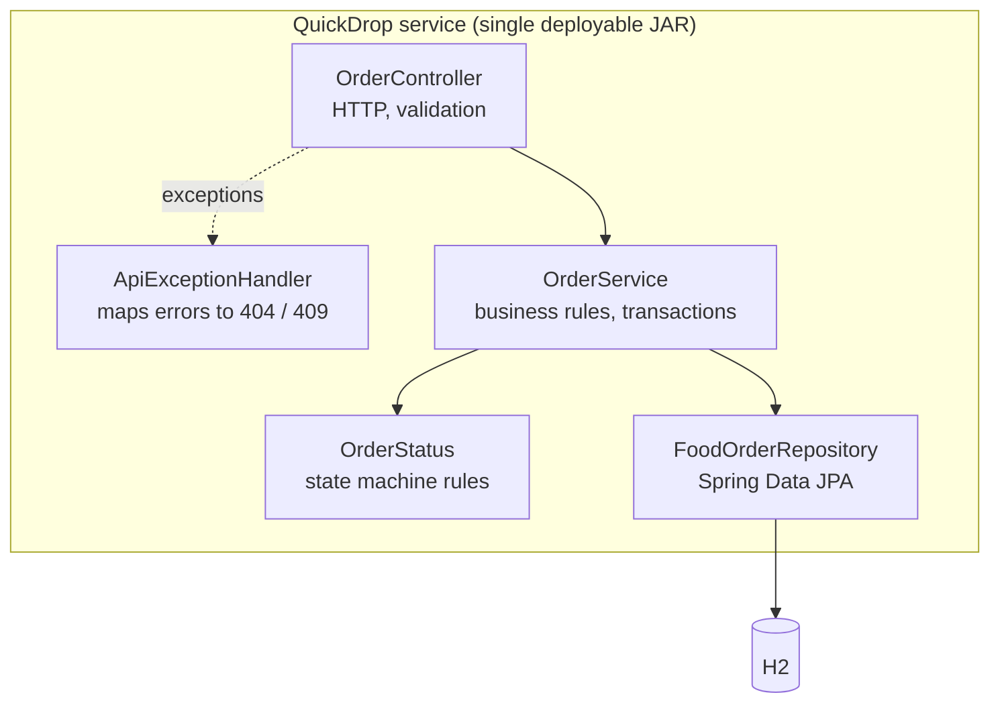
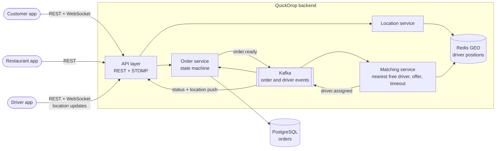
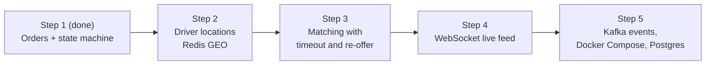

# High-Level Design (HLD)

## 1. Overview

QuickDrop is a food-delivery backend. It is built in stages. **Step 1 is implemented:** a Spring Boot service that manages orders and enforces a strict order lifecycle. Steps 2 to 5 add live driver tracking, nearest-driver matching, real-time updates and event streaming. Sections marked *Planned* are not built yet.

## 2. System context (current)

## 3. Components (current)

Responsibilities are separated so the lifecycle rules sit in one place (`OrderStatus`) and can be tested without a web server or database.

## 4. Technology choices

| Concern | Choice | Reason |
| --- | --- | --- |
| Language / runtime | Java 21 | Current LTS |
| Framework | Spring Boot 3.5 | Fast to build REST APIs, rich ecosystem |
| Persistence | Spring Data JPA, H2 file mode | No setup for step 1 |
| Validation | Jakarta Bean Validation | Declarative request checks |
| Tests | JUnit 5, AssertJ, MockMvc | Unit tests for the state machine, end-to-end API tests |

## 5. API surface (current)

| Method | Path | Purpose |
| --- | --- | --- |
| POST | `/api/orders` | Place an order, starts as `PLACED` |
| GET | `/api/orders` | List orders, optional `?status=` |
| GET | `/api/orders/{id}` | Fetch one order |
| POST | `/api/orders/{id}/status` | Move to a new status |

## 6. Key design decisions

| Decision | Why |
| --- | --- |
| State machine in one enum | Single source of truth for legal transitions, easy to test exhaustively |
| `409 Conflict` for illegal transitions | The request is valid but conflicts with the order's current state |
| Status setter is package-private | Only `OrderService` can change status, so rules cannot be bypassed |
| Separate request records from the entity | Clients cannot set `status`, `id` or timestamps directly |
| Redis GEO over PostGIS (planned) | "Nearest driver" is one command and drivers move often. PostGIS is more than this needs |
| Kafka added after the core works (planned) | Start with plain events, then move them onto Kafka, so problems are easier to isolate |

## 7. Planned target architecture (steps 2 to 5)

Not built yet.

## 8. Planned roadmap

## 9. Non-functional notes

- **Scalability:** current build is a single instance with an embedded database. The planned design moves state to PostgreSQL and Redis so the API can run as several instances.
- **Security:** none yet. No authentication, and no separation of customer, restaurant and driver roles.
- **Reliability:** state is one local file today. Planned Kafka events give a durable record of order changes.
- **Observability:** default Spring Boot logging only.
