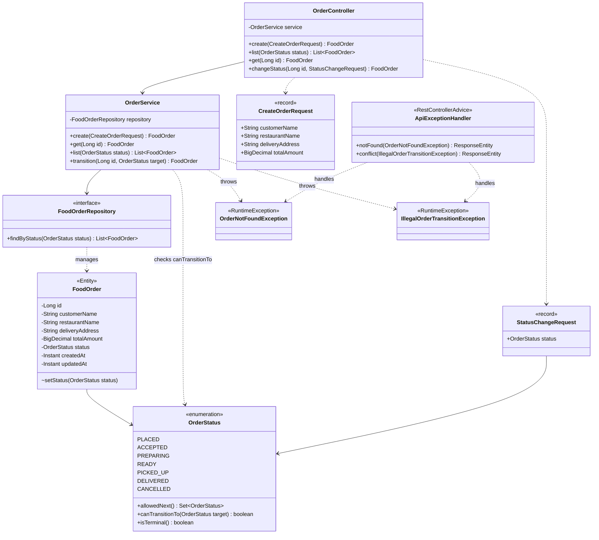
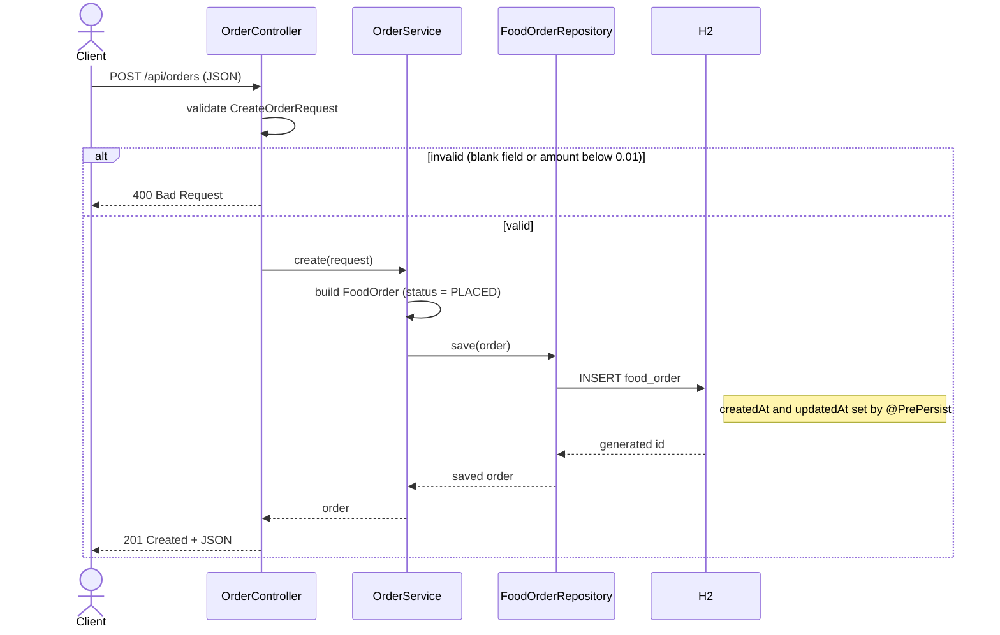
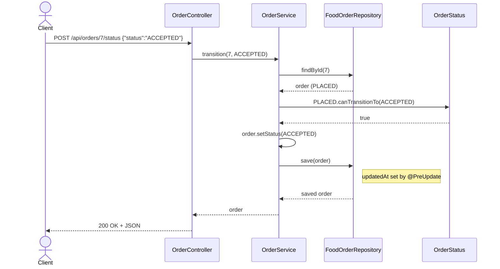
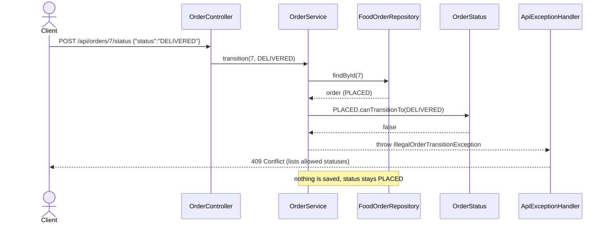
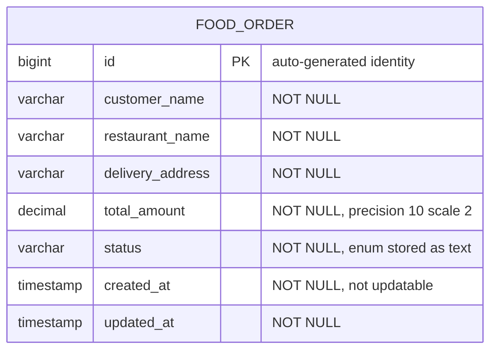
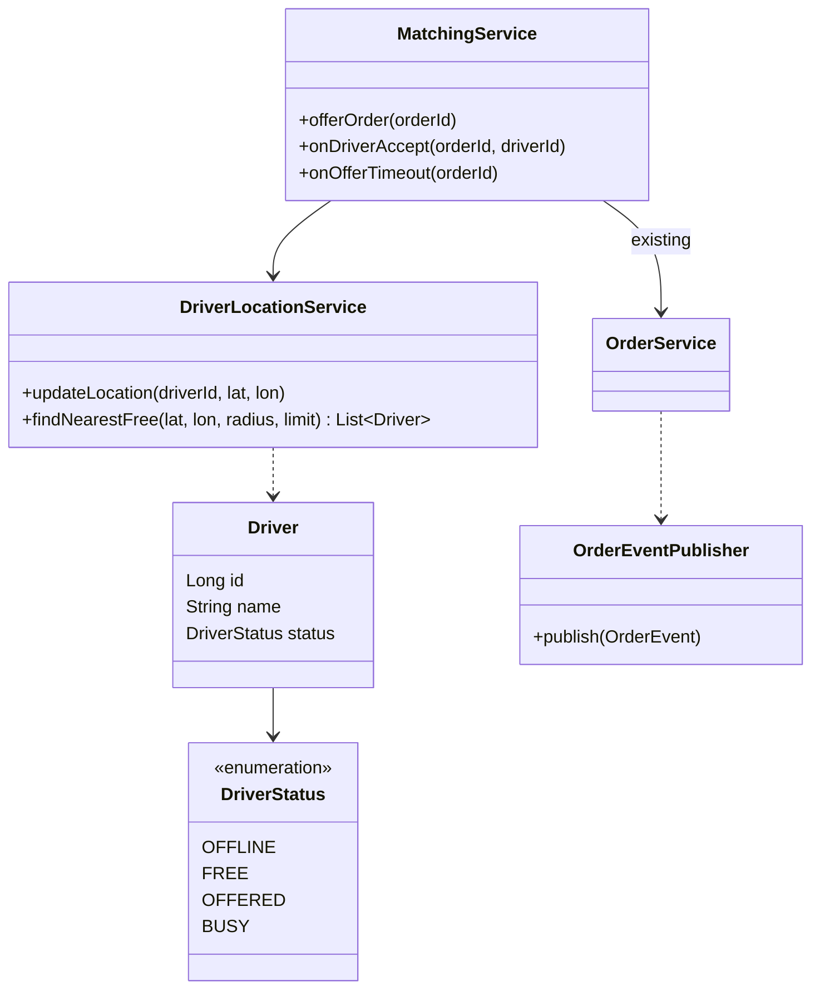

# Low-Level Design (LLD)

Describes the code as it exists today, in package `com.quickdrop`.

## 1. Package layout

```
com.quickdrop
├── QuickdropApplication                  Spring Boot entry point
└── order
    ├── OrderStatus                       enum + state machine rules
    ├── FoodOrder                         JPA entity
    ├── FoodOrderRepository               Spring Data JPA repository
    ├── OrderService                      business logic, transactions
    ├── OrderController                   REST endpoints
    ├── CreateOrderRequest                request record (validated)
    ├── StatusChangeRequest               request record (validated)
    ├── OrderNotFoundException            maps to 404
    ├── IllegalOrderTransitionException   maps to 409
    └── ApiExceptionHandler               @RestControllerAdvice
```

## 2. Class diagram



## 3. Sequence diagrams

### 3.1 Place an order



### 3.2 Change status (success)



### 3.3 Change status (rejected)



An unknown id behaves the same way, except `findById` returns empty and the service throws `OrderNotFoundException`, which the handler turns into `404 Not Found`.

## 4. State machine table

| From | Allowed next |
| --- | --- |
| `PLACED` | `ACCEPTED`, `CANCELLED` |
| `ACCEPTED` | `PREPARING`, `CANCELLED` |
| `PREPARING` | `READY`, `CANCELLED` |
| `READY` | `PICKED_UP` |
| `PICKED_UP` | `DELIVERED` |
| `DELIVERED` | none (terminal) |
| `CANCELLED` | none (terminal) |

## 5. Data model



The schema is generated by Hibernate (`ddl-auto=update`). Flyway migrations are planned with the move to PostgreSQL.

## 6. Validation rules

| Request | Field | Rule |
| --- | --- | --- |
| Create order | `customerName`, `restaurantName`, `deliveryAddress` | required, not blank |
| Create order | `totalAmount` | required, at least 0.01 |
| Change status | `status` | required, must be a valid `OrderStatus` |

## 7. Error handling

| Situation | HTTP status | Source |
| --- | --- | --- |
| Validation failure, bad JSON, unknown status value | 400 | Spring default handling |
| Order id not found | 404 | `OrderNotFoundException` |
| Transition not allowed from current status | 409 | `IllegalOrderTransitionException` |

Custom error bodies (404 and 409) use the shape `{status, error, message}`.

## 8. Planned additions to the design (steps 2 to 5)

Not built yet.



## 9. Known limitations

- No authentication, so anyone can move any order to any allowed status. Roles (customer, restaurant, driver) should restrict who may trigger which transition.
- Orders have no items, only a total amount.
- No pagination on `GET /api/orders`.
- Concurrent status changes to the same order are not guarded. A version field (optimistic locking) is a sensible fix.
