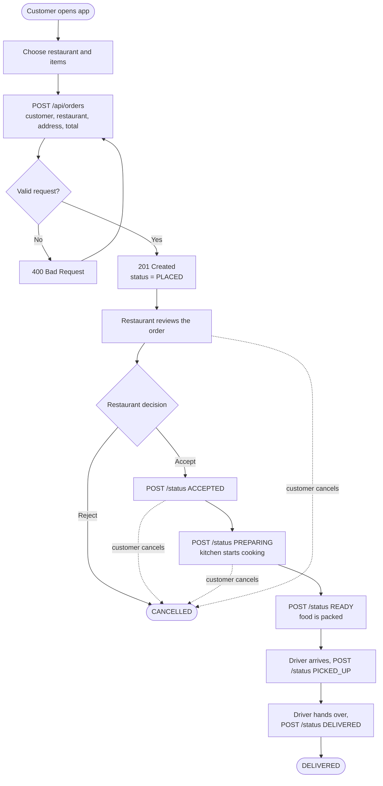
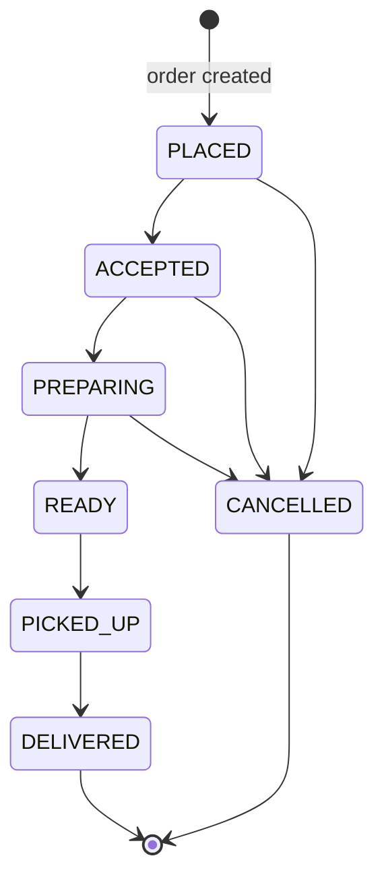
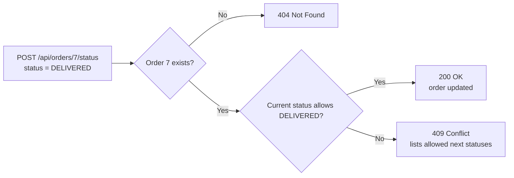
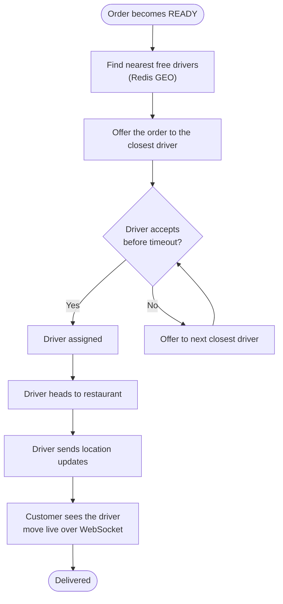

# User Flow

How an order moves through QuickDrop, and who acts at each step. The order API (step 1) is built. The driver and live-tracking parts are planned and marked as such.

## 1. End-to-end order flow

Cancelling is allowed only until the food is `READY`. After that the food has been made, so the API refuses it.

## 2. Order status lifecycle

Any move not shown above, such as `PLACED` to `DELIVERED`, returns `409 Conflict`. The error message lists the statuses that are allowed from the current one.

## 3. What happens on an illegal move

## 4. Planned: driver and live-tracking flow (steps 2 to 4)

Not built yet.

